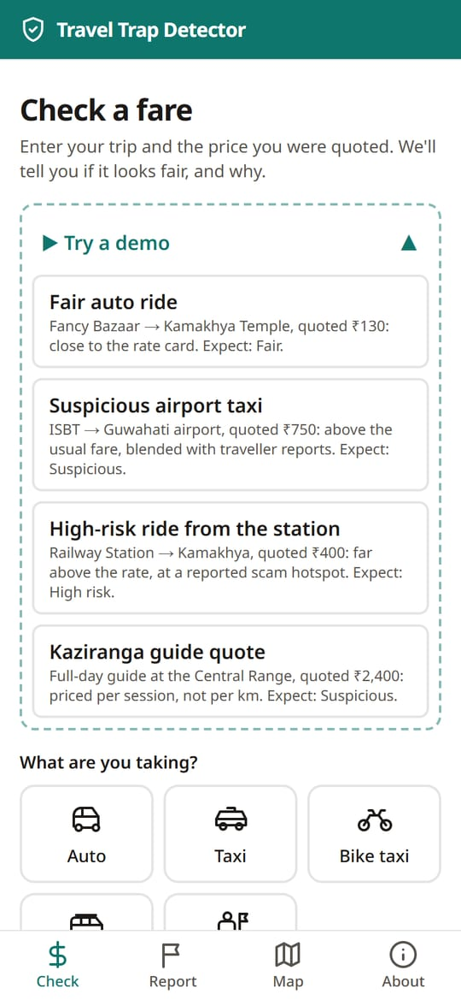
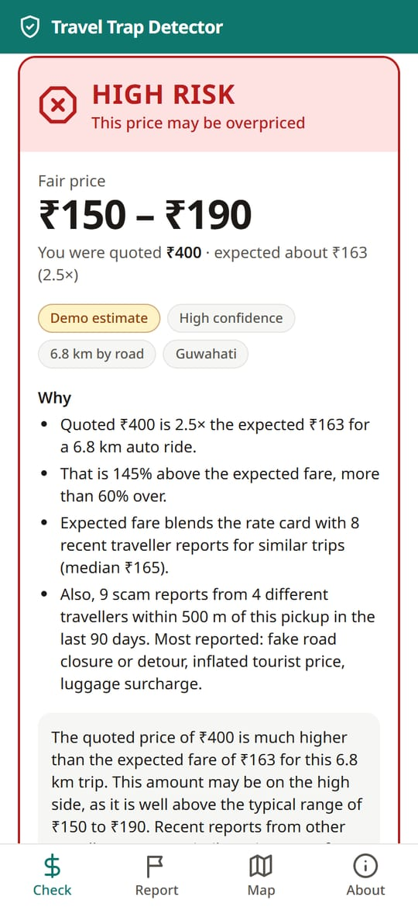
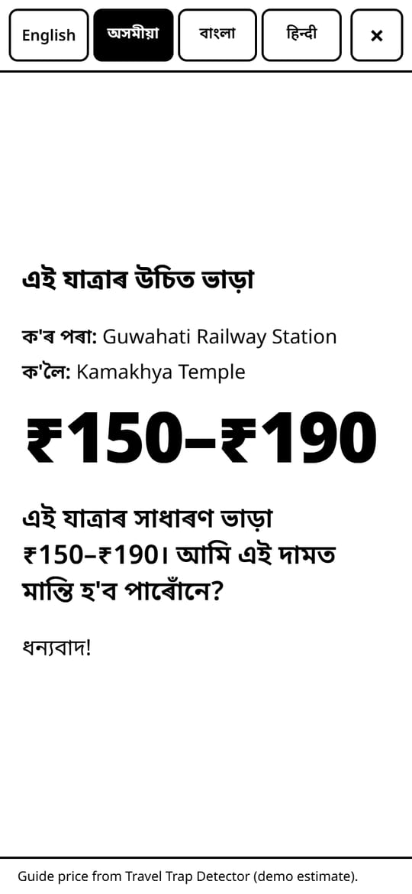
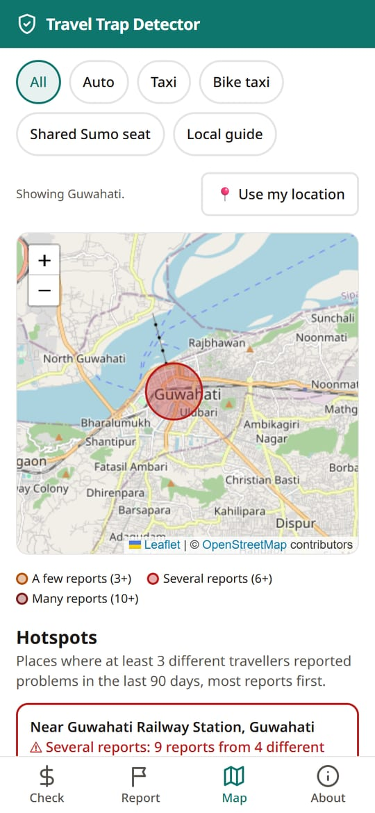
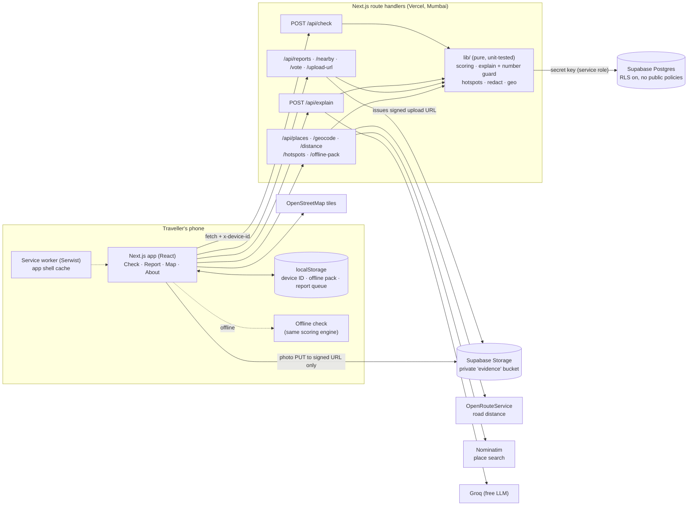

<div align="center">

# 🛡️ Travel Trap Detector

**Is this taxi fare fair? Find out in seconds, and see exactly why.**

A mobile-first web app for travellers in North East India. Enter your auto, taxi, bike taxi, shared Sumo or guide quote and get a clear verdict, a fair price range and a plain-language explanation, backed by fare data and reports from other travellers.

### [▶ Try it live: travel-trap-detector.vercel.app](https://travel-trap-detector.vercel.app)

Works on any phone browser · Installable · Works offline · Free to run

</div>

---

<table>
  <tr>
    <td align="center"><br><sub><b>Check a fare</b><br>or try a demo</sub></td>
    <td align="center"><br><sub><b>Verdict + reasons</b><br>never a bare score</sub></td>
    <td align="center"><br><sub><b>Show the driver</b><br>EN · অসমীয়া · বাংলা · हिन्दी</sub></td>
    <td align="center"><br><sub><b>Scam hotspots</b><br>from traveller reports</sub></td>
  </tr>
</table>

## Contents

- [Why it exists](#why-it-exists)
- [Features](#features)
- [Try it in 2 minutes](#try-it-in-2-minutes)
- [How a fare is checked](#how-a-fare-is-checked)
- [Data honesty](#data-honesty)
- [Privacy and security](#privacy-and-security)
- [Architecture](#architecture)
- [Run it yourself](#run-it-yourself)
- [Quality](#quality)
- [Known limitations](#known-limitations)
- [Credits](#credits)

## Why it exists

Tourists in Guwahati, Shillong, Kaziranga, Gangtok and Tawang often have no idea what a ride or a guide should cost, and "tourist pricing" is common. Travel Trap Detector gives them a quick, honest second opinion. Two principles run through it:

1. **Risk comes from pricing data *and* community intelligence.** The quote is compared with an area rate card, blended with what other travellers actually paid, and flagged when several different travellers have reported problems at the same pickup.
2. **Every verdict explains itself.** You always see the expected fare, the fair range and the reasons, never just a score.

Built for **CodeWar 8.0, Problem 5**.

## Features

| | |
|---|---|
| ✅ **Instant verdict** | **Fair / Suspicious / High risk**, the fair price range in large type, confidence, data-source and distance badges. Colour is always paired with an icon and words. |
| 🧭 **Easy trip entry** | Popular places for each area, place search, or tap on a map. Road distance is worked out automatically. |
| 💬 **Plain-language explanation** | A free AI model rewrites the reasons in friendly English plus a polite negotiation tip. Every number it writes is checked against the verdict; if anything is off, a fixed template is used instead. |
| 🪪 **Show the driver** | A full-screen, high-contrast card with the fair range and a polite line in English, Assamese, Bengali or Hindi. Keeps the screen awake. |
| 📝 **Community reports** | Report what you paid or flag a problem (tags, short note, optional photo). Phone and vehicle numbers are removed automatically; photos stay private. "Me too" on nearby reports. |
| 🗺️ **Scam hotspot map** | Places where 3+ different travellers reported problems in the last 90 days, with a service filter and an accessible list. |
| 📴 **Works offline** | Installable app. With no signal, a fare check still gives a clearly labelled offline estimate, and reports are saved and sent later. |
| ℹ️ **Transparent rules** | The About page shows the formula and every threshold, read live from the code. |

## Try it in 2 minutes

Open **[travel-trap-detector.vercel.app](https://travel-trap-detector.vercel.app)** on your phone, then:

1. Tap **Try a demo → High-risk ride from the station → Check this fare.**
   You get **High risk**: ₹400 is 2.5× the expected ₹163, *and* "9 scam reports from 4 different travellers within 500 m of this pickup".
2. Tap **Show the driver** and switch between অসমীয়া, বাংলা and हिन्दी.
3. **Try a demo → Suspicious airport taxi**: blended with 11 traveller reports, so confidence is High.
4. Open **Map**: the same two Guwahati hotspots, with the same counts as the verdict.
5. Open **About**: the exact formula and thresholds.
6. Turn on airplane mode and check another fare: "Offline estimate, community data not included".

The four demo scenarios are built to give the same verdict every time: Fair, Suspicious, High risk, and a Kaziranga guide quote (Suspicious).

## How a fare is checked

1. **Distance.** Road distance from OpenRouteService. If that isn't available, straight line × 1.3, labelled "estimate".
2. **Rate card.** `expected = max(minimum fare, base fare + per-km rate × km)`, × the night multiplier between 22:00 and 05:00 IST. Guides have half-day and full-day rates.
3. **What travellers paid.** With at least 5 similar reports (same area and ride type, distance within ±20 %, last 180 days, not scams), each scaled to your distance:
   `expected = (1 − w) × rate card + w × median paid`, with `w = min(0.5, reports ÷ 20)`.
4. **Verdict.** `quote ÷ expected`: up to **1.20** Fair · up to **1.60** Suspicious · above that **High risk**.
5. **Community warning.** At least 3 scam reports from at least 3 different travellers within 500 m of the pickup in 90 days raise the verdict one level (never above High risk), and the card says why.
6. **Fair range.** expected × 0.90 to × 1.15, rounded to ₹10.
7. **Confidence.** High: local rate card + 5 or more reports. Medium: local rate card only. Low: outside the listed areas.

All thresholds live in [`lib/config.ts`](lib/config.ts); the scoring engine is a pure, unit-tested function in [`lib/scoring.ts`](lib/scoring.ts).

## Data honesty

- **Rate cards are placeholders.** Every rate in this prototype is a plausible demo value, shown with a **"Demo estimate"** badge on every verdict. Replacing them with official fare charts means editing one table in [`supabase/seed.sql`](supabase/seed.sql); the badge then reads "Official fare chart".
- **Seed reports are synthetic.** The 100 starter reports (`is_seed = true`) exist to demonstrate the community features, including the two Guwahati hotspots.
- **Places** come from OpenStreetMap. A few points are approximate (which Guwahati airport terminal handles arrivals, Pakyong airport, the centre of Police Bazar).
- **Translations** on the driver card are first drafts awaiting review by native speakers.

## Privacy and security

- **No accounts, no personal data.** A random device ID kept on the phone is used only for rate limits (30 checks and 5 reports per hour) and "Me too" votes.
- **Places and patterns, never people.** Phone numbers and vehicle registration numbers are removed from report text on the server.
- **Private photos.** Evidence photos are shrunk on the phone (which also strips location metadata), stored in a private bucket, and never shown to anyone, only "evidence attached".
- **Locked-down database.** The browser never talks to the database: every read and write goes through the app's server with a secret key. Row-level security is on for every table with no public policies.
- **Checked:** the deployed browser bundle and the git history were scanned for every key name and value: no secrets. Verify the database yourself with [`supabase/checks/verify-security.sql`](supabase/checks/verify-security.sql) or `npm run rls:check`.

## Architecture



**Stack:** Next.js 16 (App Router, TypeScript, Tailwind CSS 4) · Supabase Postgres + Storage · Leaflet + OpenStreetMap · OpenRouteService · Groq · Serwist (PWA) · zod · Vitest · Vercel.

Every external service is a free tier, and each has a fallback: no road distance → straight-line estimate; no AI → template explanation; no place search → popular places list; no connection → offline estimate and report queue.

```
app/            pages, API route handlers, service worker, web manifest
components/     fare check, verdict card, place picker, reports, map, driver card
lib/            scoring, explanations + number guard, hotspots, redaction, geo, config
supabase/       schema + row-level security (migrations), seed data, security check
tests/          unit tests
docs/           deployment guide and phone test checklist, screenshots
```

## Run it yourself

Requirements: **Node 24** and free accounts (no card) for Supabase, plus optionally OpenRouteService and Groq.

```bash
npm install
cp .env.example .env.local      # fill in the values below
```

1. **Database:** create a free Supabase project. In **SQL Editor**, run [`supabase/migrations/001_init.sql`](supabase/migrations/001_init.sql), then [`supabase/seed.sql`](supabase/seed.sql).
2. **Check it:** `npm run db:check` should end with "All checks passed".
3. **Run:** `npm run dev`, then open http://localhost:3000.
4. **Deploy:** follow [docs/DEPLOY.md](docs/DEPLOY.md) (GitHub → Vercel, environment variables, security checks, phone test checklist).

| Variable | Required | Purpose |
|---|---|---|
| `SUPABASE_URL` | yes | Project URL, e.g. `https://<ref>.supabase.co` |
| `SUPABASE_SECRET_KEY` | yes | Secret (service role) key. **Server only; never `NEXT_PUBLIC_`.** |
| `ORS_API_KEY` | no | OpenRouteService road distances. Without it: straight line × 1.3. |
| `LLM_BASE_URL` | no | Any OpenAI-compatible endpoint (default Groq) |
| `LLM_API_KEY` | no | Groq key. Without it: template explanations. |
| `LLM_MODEL` | no | Default `qwen/qwen3.8-27b` |
| `LLM_REASONING_EFFORT` | no | `none` for Qwen 3, `low` for gpt-oss |

| Command | What it does |
|---|---|
| `npm run dev` | Development server |
| `npm run build` / `npm start` | Production build and server (includes the offline service worker) |
| `npm run check` | Lint + typecheck + all unit tests |
| `npm run db:check` | Database row counts, seed sanity, private bucket, hotspot check |
| `npm run rls:check` | Tries to read and write everything with the *public* key; all must be blocked |

## Quality

- **255 unit tests** (Vitest) covering scoring rules and boundaries, time windows, distances, the AI number guard, explanations, redaction, hotspots, the offline check, the report queue and the demo scenarios.
- **Lighthouse (mobile, live site):** accessibility **100** on every page; performance **90–97**; best practices **100** (96 on the map, because of the map tiles); SEO **100**.
- **Accessibility:** every control is labelled, keyboard focus is visible, colour contrast meets WCAG AA, and verdicts are never shown by colour alone.

## Known limitations

- **Placeholder rate cards.** Verdicts are a guide until official fare charts are added.
- **Device IDs can be faked.** One person could pose as several travellers. Rate limits and the 3-traveller rule reduce, but don't remove, this risk.
- **Small community sample.** Real reports are few so far, so most checks lean on the rate card.
- **Hill roads.** If road distance is unavailable, the straight-line estimate can be about half the real distance around Gangtok and Tawang.
- **Route-based fares.** Many shared taxis charge a fixed fare per seat per route, which the per-km model only approximates.
- **Offline estimates** don't include traveller reports or warnings.

## Credits

Map data and place search © [OpenStreetMap](https://www.openstreetmap.org/copyright) contributors (ODbL) · Road distances by [OpenRouteService](https://openrouteservice.org) · Fonts: Noto Sans family (SIL OFL) · Built with Next.js, Supabase, Leaflet, Serwist and zod.
